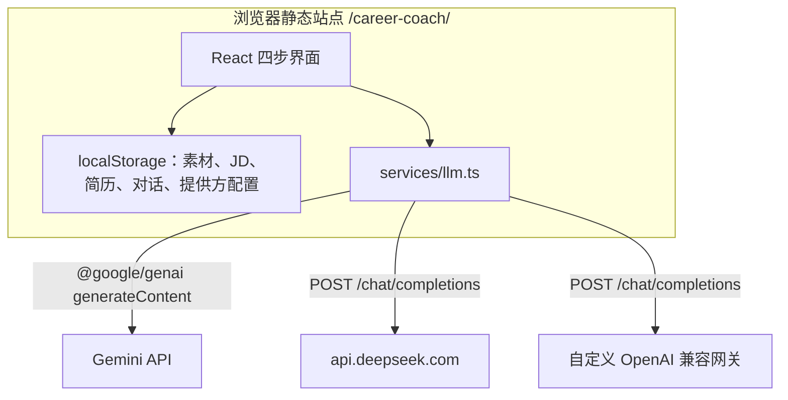

<div align="center">

# AI 求职智航 Pro

面向技术岗求职者的四步助手：把项目讲清楚，解析目标 JD，生成对齐后的简历项目描述，再按这些素材做模拟面试。

[lijiaxing.com.cn/career-coach/](https://lijiaxing.com.cn/career-coach/)

</div>

## 项目背景

技术候选人常有真实项目，但写简历和准备面试时容易变成形容词堆砌：经历对不齐某一份 JD，追问时又说不出行动和结果。

求职智航把这件事收成一条本地流程。素材、职位、简历草稿和面试复盘都留在浏览器里。模型调用由使用者自己的密钥发起，站点本身不保存密钥，构建产物里也不包含密钥。原型最初在 Google AI Studio 里起草，现在按静态站点部署，并可在 Gemini 之外改用 DeepSeek 或其它 OpenAI 兼容网关。

## 技术方案

前端是 **React 19 + TypeScript + Vite 6**，没有业务后端。界面以中文为主。样式用 Tailwind CDN，图标用 Font Awesome。

模型访问收口在 `services/llm.ts`：

| 提供方 | 调用方式 | 默认模型 | 密钥存在哪 |
| --- | --- | --- | --- |
| Gemini | 浏览器里的 [`@google/genai`](https://googleapis.github.io/js-genai/) `generateContent` | `gemini-2.0-flash` | `localStorage` |
| DeepSeek | `POST https://api.deepseek.com/chat/completions`（OpenAI 兼容） | `deepseek-chat` | `localStorage` |
| 自定义 | `POST {Base URL}/chat/completions` | 使用者填写 | `localStorage` |

四个步骤都走这一个入口。结构化结果（素材、JD、简历、复盘）要求模型返回 JSON；对话追问走普通文本补全。DeepSeek 默认使用 `response_format: json_object`，若网关不接受该字段，会自动去掉后再请求一次。`deepseek-reasoner` 可以在设置里改，但结构化步骤更适合 `deepseek-chat`。

密钥不再通过 Vite `define` 注入 `process.env.API_KEY` / `GEMINI_API_KEY`。不要把密钥写成 `VITE_` 变量，否则会被打进前端包。

语音是可选项：浏览器支持 `SpeechRecognition` 时，可以把口述写进输入框；权限被拒绝或不支持时，继续打字即可。面试和挖掘不依赖 Gemini Live。

### DeepSeek 示例

1. 在 [DeepSeek 开放平台](https://platform.deepseek.com/) 创建 API Key。
2. 打开求职智航，点右上角「设置密钥」。
3. 选择 **DeepSeek**。
4. 粘贴 Key，模型保持 `deepseek-chat`（或改成 `deepseek-reasoner`）。
5. 点「测试连接」。成功后再保存。请求发往 `https://api.deepseek.com/chat/completions`，`Authorization: Bearer <你的 Key>`。
6. 换浏览器或清空站点数据后需要重新填写。Key 不会出现在仓库或构建产物里。

Gemini 同样在设置里填写 Key，默认模型是 `gemini-2.0-flash`，可以改成账号实际可用的模型 ID。自定义网关需要填写 Base URL、Key 和模型 ID，并且该网关必须允许页面来源跨域。

## 技术架构



```
浏览器
  App.tsx                         步骤状态，写入 localStorage
  components/Step1..Step4         挖掘 / JD / 简历 / 面试
  components/SettingsModal        提供方、模型、密钥
  services/career.ts              各步骤的提示词
  services/llm.ts                 Gemini SDK 或 OpenAI 兼容补全
  services/openaiChat.ts          DeepSeek 与自定义网关
```

刷新页面会恢复素材、职位库、选中的 JD、简历草稿、两段对话和复盘记录。密钥存在另一条 `localStorage` 记录里。

## 功能点

1. **项目挖掘。** 和面试官式助手对话，或粘贴一段经历，整理成背景、任务、行动、结果、技术栈和难点。也可以手动补一条。模型不得编造材料里没有的指标；没有数字时记为「未提供量化结果」。
2. **JD 解析与管理。** 粘贴职位描述，抽出公司、职位、关键词和胜任力。可以保存多份、切换当前目标、删除。切换目标会清掉上一份已生成的简历，避免文案串岗。
3. **简历生成。** 用当前素材和选中的 JD 写 STAR 项目描述，并给出 0–1 的匹配度。缺少的数字保留「待补充」占位，不虚构百分比。可复制全文。
4. **模拟面试。** 按素材、JD 和简历草稿逐题追问。结束后生成复盘：总体表现、改进建议、缺口，以及可以回扣的素材名称。
5. **提供方切换。** Gemini、DeepSeek、自定义 OpenAI 兼容接口。缺密钥时，步骤会打开设置，而不是静默失败。
6. **可选语音输入。** 麦克风失败时退回文字，不阻断四个步骤。

## 本地运行

需要 Node.js 18 或更高版本。

```bash
git clone https://github.com/Timelovers/AI-Career-Coaching-Navigator-.git
cd AI-Career-Coaching-Navigator-
npm install
npm run dev
```

开发服务器监听 `0.0.0.0:3000`。因为部署基路径是 `/career-coach/`，请打开：

```text
http://localhost:3000/career-coach/
```

不需要 `.env` 或 `.env.local`。启动后在页面设置里填写密钥。

检查请求拼装（不访问真实模型）：

```bash
npm test
```

生产构建：

```bash
npm run build
npm run preview
```

预览地址是 `http://localhost:4173/career-coach/`。

## 密钥说明

- 在页面「设置」中选择 Gemini、DeepSeek 或自定义接口，填写 API Key 和模型 ID。
- 配置键名是 `career-coach.provider`，业务数据键名是 `career-coach.state`，都只在本机浏览器。
- 仓库、GitHub Actions 和 `vite build` 产物都不包含使用者的密钥。
- 这是纯前端应用。任何能在页面里执行脚本的人都能读到 `localStorage`。不要在不受信任的设备上保存密钥。
- 页面从 CDN 加载 Tailwind 和 Font Awesome，并按所选提供方把职位文本和项目经历发给对应的模型服务。

## 静态部署

构建基路径固定为 `/career-coach/`，对应 [lijiaxing.com.cn/career-coach/](https://lijiaxing.com.cn/career-coach/)。

```bash
npm run build
```

把 `dist/` 的内容发布到站点的 `/career-coach/` 目录（或等价的静态路径）。入口、脚本和资源都会带上这个前缀。需要临时换路径时，可以用 Vite 的命令行覆盖配置：

```bash
npx vite build --base /career-coach/
```

发布后打开该路径，在设置里保存自己的 Gemini 或 DeepSeek 密钥，再走四步流程。DeepSeek 与 Gemini 的接口都允许从 `https://lijiaxing.com.cn` 发起浏览器跨域请求。自定义网关需要自行打开 CORS。

## English

AI Career Coaching Navigator is a static React app for technical job seekers: project discovery, JD parsing, JD-aligned resume bullets, and a mock interview. Gemini (`gemini-2.0-flash` via `@google/genai`), DeepSeek (`deepseek-chat` at `https://api.deepseek.com`), and any OpenAI-compatible gateway are selected in Settings. API keys stay in `localStorage` and are not compiled into the bundle. Build with `base: '/career-coach/'` and publish `dist/` under that path.

## 联系

- GitHub：[@Timelovers](https://github.com/Timelovers)
- 主页：[lijiaxing.com.cn](https://lijiaxing.com.cn/)
